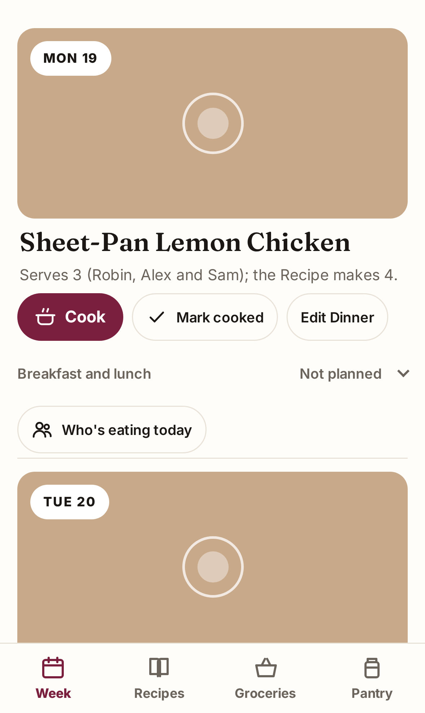

# Mise

A self-hosted family meal planner. See `SPEC.md` for the product and architecture.



## Allergens

Mise checks Recipes against the Household's allergies by looking up each Ingredient in a built-in Item catalogue (`packages/domain/src/catalogue.ts`). An AI drafted that catalogue, and a maintainer reviews it, but **it is not guaranteed to be complete or correct**: brands and recipes vary by country and change over time, and many Items are tagged from what is typical rather than from a specific product's label. Ingredients Mise can't match are treated as conflicting with every allergy, but a matched Item can still be wrong. The same goes for Items your Household adds on the Resolve Ingredients screen: Mise trusts the Allergens chosen there for every Recipe that uses them. Use Mise as a planning aid, not as a substitute for reading labels or for medical advice.

## Development

Requires Bun and Node.js.

```sh
bun install
cp apps/worker/.dev.vars.example apps/worker/.dev.vars   # who you are locally, since there is no Access
bun run dev          # builds the PWA, then runs the Worker with `wrangler dev` on :8787
bun run seed         # sets up the fictional sample Household (fixtures/) on the local Worker
```

For a hot-reloading UI, run `bun run dev` in `apps/web` alongside `wrangler dev` in `apps/worker`.

```sh
bun run lint
bun run typecheck
bun test packages    # domain tests
bun run test:worker  # tool-seam tests in workerd
bun run test:web     # component tests in jsdom
bun run check:private  # no personal emails committed
```

`bun run screenshot` retakes `docs/screenshots/` from the fictional sample Household and its Week (`fixtures/sample-week.json`) on a throwaway local deployment. Look the images over before committing them. It needs Playwright's Chromium once: `bunx playwright install chromium`. `--screens` takes every screen into `dist/screens/` for a design review instead (`--only week,import` for some of them), and `--check` lists the screens taken before the web source last changed.

## Deployment

Each deployment is one Household at its own hostname, behind Cloudflare Access with Google sign-in. Every deployment-specific value lives in Pulumi Cloud and Pulumi ESC, never in this repo (ADR 0005); `infra/Pulumi.example.yaml` lists the settings. To set one up:

```sh
bun run wizard
```

The wizard walks you through Pulumi Cloud, a Cloudflare API token, a Google OAuth client, the ESC environment and the GitHub secrets and variables. Its answers stay in `~/.config/mise/deploy.env`. After that, every push to `master` runs `pulumi up` (Access, R2, the custom domain and its DNS record) and then `wrangler deploy`, which uploads the Worker secrets Pulumi computed. On a brand-new deployment the hostname binds on a second `pulumi up` in the same run, once the Worker exists.

The Worker checks the Access token on every request and passes the signed-in email into tool calls (ADR 0007). `/cal/*` skips sign-in.

## Share to Mise from an iPhone

An iOS Shortcut puts "Mise" in the iPhone share sheet: it opens `/share?url=…` in Safari, behind Access, and that page imports the link. [docs/share-from-iphone.md](docs/share-from-iphone.md) has the steps to build it.

## The agent

"Ask Mise" in the header opens a chat with an agent on Claude (Anthropic). It reads and changes the Household only through the same tools the screens use. It needs the `mise:anthropicApiKey` setting, which becomes the `ANTHROPIC_API_KEY` Worker secret; without it the chat answers nothing. **Set a monthly spend limit in the Anthropic console** (Settings → Limits): Mise has no cap of its own. For `wrangler dev`, put the key in `apps/worker/.dev.vars`.

## Google Drive folder

A shared Google Drive folder can be Mise's inbox: anyone drops a Google Doc in it, and by the next morning the Doc is a Draft Recipe waiting on the review screen. "Sync Drive now" on the Import screen reads it straight away. Subfolders become tags, read as Paprika categories are ("Desserts", "Indian"); a flat folder works too. The first image in a Doc becomes the Recipe's photo. A Doc that holds no recipe is listed in the run log, with its link, and skipped until it changes. An edited Doc updates its Draft, or raises an Import Flag if its Recipe was edited or accepted in Mise. A Doc removed from the folder leaves its Recipe in Mise. Mise never writes to the folder. Only Google Docs are read: a shortcut, a PDF or a Word file in the folder is ignored, so convert or copy it into a Doc.

Mise reads the folder as a Google Cloud service account, so any Google account can share a folder with it, with no Workspace admin needed. To connect one:

1. In the [Google Cloud console](https://console.cloud.google.com/), pick or create a project and enable the **Google Drive API** (APIs & Services → Library).
2. Create a service account (IAM & Admin → Service Accounts → Create). It needs no roles. Open it, then Keys → Add key → Create new key → JSON, and keep the downloaded file safe: it is the key.
3. In Google Drive, share the folder with the service account's email (`<name>@<project>.iam.gserviceaccount.com`) as a **Viewer**.
4. Copy the folder's id, the end of its URL: `https://drive.google.com/drive/folders/<folder id>`.
5. Add both to your ESC environment, as `infra/Pulumi.example.yaml` shows: `mise:driveFolderId`, and `mise:googleServiceAccountKey` as a secret holding the key file's JSON on one line. `bun run wizard` asks for the key file and the folder id and does this for you. They become the `DRIVE_FOLDER_ID` and `GOOGLE_SERVICE_ACCOUNT_KEY` Worker secrets on the next deploy.

The sync runs at 04:00 Household time, after the nightly Backup. The model reads each new or changed Doc, so the Anthropic key is needed too. One sync reads at most 25 Docs, and the next one carries on. Without both settings there is no sync, and "Sync Drive now" says so.

## Notifications

Each phone, tablet or computer can turn on notifications under Household → Notifications, and choose which kinds it gets: next week proposed, a pantry check due, a Prep-ahead note for tomorrow, something waiting on the review screen, and a Drive sync that flagged a Recipe. They are web push notifications, so on an iPhone or iPad they need Mise added to the Home Screen and opened from there (iOS 16.4 or later). Every device that turns them on gets every kind it chose, whoever signed in on it.

At 08:00 Household time, two days before a Week starts, Mise proposes it if none of its dinners is planned yet, and says so. It never proposes again a Week someone has started, even with one dinner out. The same morning it asks for a pantry check if Staples are due, and every morning it sends tomorrow's dinner's Prep-ahead note. A Drive sync says what it left on the review screen, and Suggestions say so when they arrive after an import.

Notifications need a VAPID key: a P-256 key pair that identifies Mise to Apple's, Google's and Mozilla's push services, with no account to register. `bun run wizard` makes one with `openssl` and puts it in your ESC environment as `mise:vapidPrivateKey`, which becomes the `VAPID_PRIVATE_KEY` Worker secret; `VAPID_SUBJECT` is set to `https://<your hostname>`. To make one by hand, see `infra/Pulumi.example.yaml`. **Keep the key**: every device subscribes with it, so a new key turns notifications off on every device until it turns them on again. Without the key there are no notifications, and the Notifications screen says so. The devices are in the nightly Backup, so a restore keeps them.

## Backup and restore

At 03:00 Household time the household Durable Object writes a Backup of all Household data to R2 at `exports/<date>.json`. It keeps the newest 30 Backups and the earliest of every month, and deletes the rest; a file you put under `exports/` yourself is never deleted (ADR 0006). To take one by hand or restore one into a fresh deployment:

```sh
cloudflared access login https://mise.example.com
cloudflared access curl https://mise.example.com/agents/household/household/export > export.json
cloudflared access curl -X POST -H 'Content-Type: application/json' --data-binary @export.json \
  https://mise.example.com/agents/household/household/restore
```

Restore refuses a household that already holds data. The Worker only accepts people signed in through Access, so service tokens don't work here.

## Observability

Errors and traces go to Sentry when the `SENTRY_DSN` Worker secret is set. The SDK collects no user info, cookies, bodies, query strings or AI inputs and outputs, and `apps/worker/src/observability.ts` scrubs events and spans again before they leave. There is no other third-party analytics.

## Layout

- `packages/domain`: pure TypeScript: the Household model and the tool registry. No Cloudflare or Bun imports.
- `apps/worker`: the household Durable Object (an Agents SDK `Agent`) and its single `callTool` entry point.
- `apps/web`: the SolidJS PWA.
- `infra`: Pulumi program for a deployment.
- `scripts`: the deployment wizard and the private-values check.
